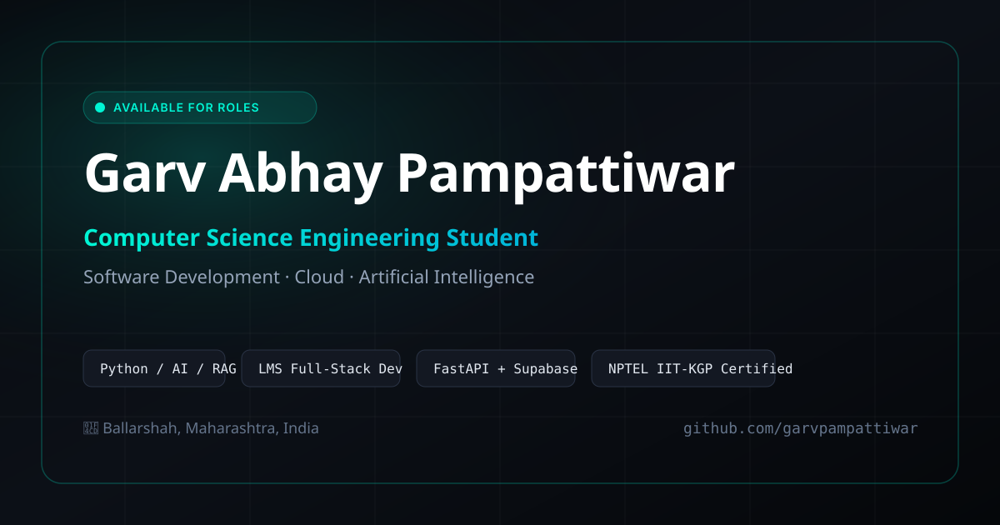

# Garv Abhay Pampattiwar — Personal Portfolio Website

A distinct, modern, and tech-forward developer portfolio for **Garv Abhay Pampattiwar**, Computer Science Engineering student specializing in Python, Full-Stack LMS Architecture, Machine Learning, and AI RAG Systems.



---

## ⚡ Highlights & Design Direction

- **Tech-Forward Midnight Aesthetic**: High-contrast dark theme with curated **Electric Cyan** (`#00f5d4`) accenting, custom glassmorphism, and radial glow shaders.
- **Light / Dark Theme Switcher**: Instant theme toggling with high-contrast WCAG AA accessible color ramps and `localStorage` persistence.
- **Interactive Ambient Canvas**: Smooth particle constellation background reacting subtly to cursor physics without lagging the browser.
- **Interactive `Garv-CLI` Terminal**: Embedded terminal emulator in the hero section where recruiters and engineers can test commands (`whoami`, `skills`, `projects`, `exp`, `edu`, `cert`, `contact`, `clear`) or click auto-executing chips.
- **Editorial Bento Grid Layouts**: Asymmetrical project cards highlighting deep technical architecture, metrics, and GitHub code repositories.
- **Circuit-Board Timeline**: Visual career progression featuring detailed bullet cards for VedaLeo (Next.js, FastAPI, Supabase, Groq LLM API), Code-A-Nova, and more.
- **Interactive Skills Filter**: Real-time filtering across Programming, Web Tech, Machine Learning & AI, Core CS, and Tools.
- **Zero-Dependency Static Architecture**: Pure semantic HTML5, modern CSS3 (Custom Properties & Grid/Flexbox), and vanilla JS. Loads in milliseconds, zero build step needed.

---

## 📁 Project Structure

```
d:/portfolio/
├── index.html          # Semantic HTML5, SEO meta tags, OpenGraph, JSON-LD structured schema
├── css/
│   ├── style.css       # Design tokens, typography, component layouts, dark/light themes
│   └── animations.css  # Scroll-reveal keyframes, micro-interactions, accessibility rules
├── js/
│   ├── main.js         # Navigation, theme toggle, form validation, copy-to-clipboard, toast
│   ├── canvas.js       # Interactive constellation particle network with theme awareness
│   └── terminal.js     # Interactive Garv-CLI terminal emulator with command history
├── assets/
│   ├── favicon.svg     # Custom SVG monogram favicon (GP)
│   └── og-image.svg    # Open Graph 1200x630 social share card
├── vercel.json         # Security headers and clean URLs for Vercel deployment
└── README.md           # Documentation & deployment guide
```

---

## 🚀 How to Run Locally

Because this project is built with vanilla web technologies, you do **not** need `npm install` or complex bundlers! You can run it immediately with any of the following methods:

### Option 1: Python Built-in Server (Recommended)
Open your terminal in the `portfolio` folder and run:
```bash
python -m http.server 3000
```
Then visit `http://localhost:3000` in your web browser.

### Option 2: Node.js (npx serve)
```bash
npx serve .
```
Then open the displayed local URL (typically `http://localhost:3000`).

### Option 3: VS Code Live Server
1. Open the folder in VS Code.
2. Right click `index.html` and choose **"Open with Live Server"**.

---

## 🌐 How to Deploy for Free

### 1. Deploying to Vercel
1. Install Vercel CLI (`npm i -g vercel`) or sign in at [vercel.com](https://vercel.com).
2. Push your project to a GitHub repository or run `vercel` in the project root.
3. Vercel automatically detects the static site and deploys in seconds! The included `vercel.json` ensures optimized security headers.

### 2. Deploying to Netlify
1. Sign in to [netlify.com](https://www.netlify.com).
2. Drag and drop the `portfolio` folder into the Netlify dashboard, **OR** connect your GitHub repository with publish directory set to `/` (root).
3. Instant live HTTPS URL!

### 3. Deploying to GitHub Pages
1. Push this folder to a GitHub repository named `garvpampattiwar.github.io` (or `portfolio`).
2. In the repository settings, navigate to **Pages** (under Code and automation).
3. Set **Source** to `Deploy from a branch` and choose the `main` branch with folder `/ (root)`.
4. Click **Save**. Your site will be live at `https://garvpampattiwar.github.io/`!

---

## 📬 Contact & Information

- **Name**: Garv Abhay Pampattiwar
- **Email**: [garvpampattiwar@gmail.com](mailto:garvpampattiwar@gmail.com)
- **Phone**: [+91 88301 84843](tel:+918830184843)
- **LinkedIn**: [linkedin.com/in/garv-pampattiwar819643299](https://linkedin.com/in/garv-pampattiwar819643299)
- **GitHub**: [github.com/garvpampattiwar](https://github.com/garvpampattiwar)
